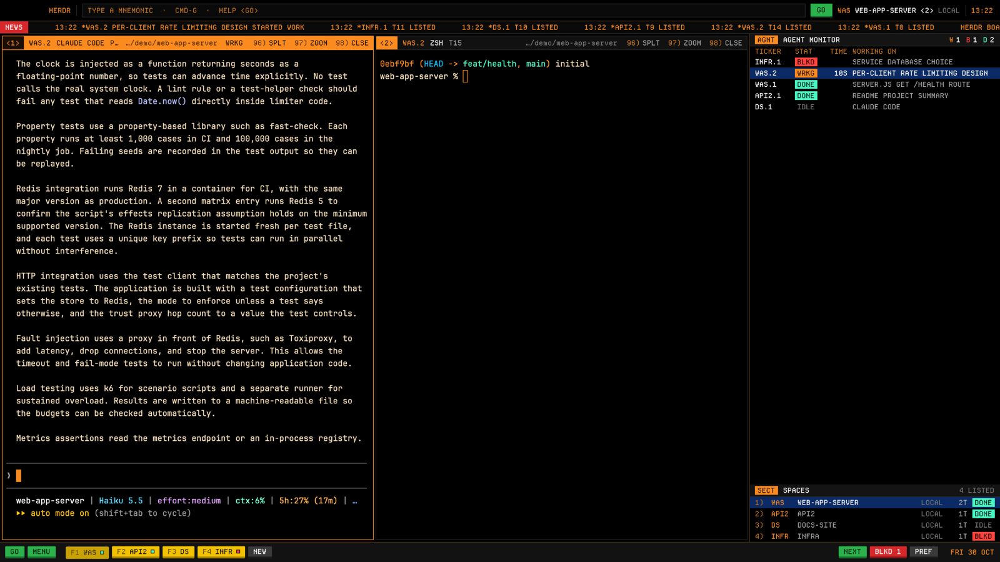

# Herdr Terminal

A Bloomberg terminal for your agents. Black glass, amber type, a bitmap grid
face. You run the window from a command line of four-letter mnemonics and
`<GO>`. A news tape reports every agent that starts, finishes or blocks. An
agent monitor lists every agent as a quote-board row, blocked first. Along
the bottom is a keyboard of colored keycaps, one per space.

## What you see

A column, top to bottom, filling the window (no system title bar; the
traffic lights sit at 12,11 on black):

1. **The command line**, 34px, black, amber 1px rule below (`#4a2f12`).
   After 78px of room for the window buttons: **HERDR** in bold amber, a
   rule, then the field: a 22px box (`#0a0a0a`, 1px `#262626`; `#140b02`
   with an amber border when it has the keyboard). Empty, it reads
   "TYPE A MNEMONIC · CMD-G · HELP <GO>" in dim amber (`#c27420`). Typed
   text is white and uppercase, with a blinking amber block caret. To the
   right of the typed text, up to four matching mnemonics with their
   meaning. After a run, the result shows in green ("CLDE <GO>") or red
   ("UNKNOWN MNEMONIC XYZ. HELP <GO> LISTS THEM"). Then a green **GO** key,
   the context (space code in amber, SPACE NAME <tab>, machine or LOCAL in
   gray) and an `HH:MM` clock in amber.
2. **The news tape**, 20px, `#0a0a0a`: a red **NEWS** box, then amber type.
   It shows the board line ("HERDR BOARD 6 AGENTS WRKG 2 BLKD 1 DONE 1
   IDLE 2"), one "*WAS.1 WAITING ON YOU" per blocked agent, and the last ten
   headlines ("14:32 *WAS.1 BUILD FINISHED").
3. **The desk**, a row with a 1px `#4a2f12` divider:
   - **The panels**: the shown tab's terminals on black, 3px apart, square,
     1px `#262626` borders, amber when focused. Each has a 22px
     **panel strip** header: `<n>` in an amber box, the ticker (`WAS.1`),
     the program (CLAUDE, SHELL), its title, the short folder (`…/src/api`),
     a status cell, and three numbered actions: `96) SPLT`, `97) ZOOM`
     (UNZM when zoomed), `98) CLSE`. The focused panel's strip is solid
     amber with dark ink; the rest are `#111111` with amber.
   - **The monitor**, 400px (300–720, resizable):
     - The **AGNT AGENT MONITOR** heading has an amber mnemonic box and a
       W/B/D tally.
     - A column header (TICKER · STAT · TIME · WORKING ON) sits in dim amber.
     - Then every agent as an 18px row: ticker, status cell, time in that
       state (45S, 12M, 3H07, 2D), its title uppercase. The focused agent's
       row is Bloomberg blue (`#0b2a66`).
     - Below that is **SECT SPACES**: each space as an 18px row with its
       number, its code, its name, its machine or LOCAL, its tab count
       (`3T`) and its most urgent status cell. At most six rows show, and
       the list scrolls past that.
   - A hidden `changes` block (the shipped mod) under the monitor; CHNG
     shows it.
4. **The keyboard**, 32px, `#121212`, amber rule above. These are
   keycaps: 20px faces with a lit top edge and a 3px dark lip.
   - **GO** and **MENU** are green.
   - One yellow market key per space, `F1 WAS`. The shown space's key is
     pressed in. A 6px square on the key shows the space's most urgent
     status color.
   - A gray **NEW** key.
   - On the right: green **NEXT**, then **BLKD** (red, "BLKD 2", when
     anyone is blocked; gray otherwise), then gray **PREF**, then the date
     in amber ("THU 29 OCT").

Status cells are 36×14 filled four-letter words:
- WRKG: amber `#fb8b1e` with dark ink.
- BLKD: red `#ff433d`.
- DONE: green `#4af6c3`.
- IDLE: dim gray text, no fill.

Type: Departure Mono (bundled, OFL), 11px with a 14px line, for every
piece of chrome. JetBrains Mono 13px in the terminals, with 6×10px padding.
The `bloomberg` theme sets an amber-on-black terminal palette (cursor
`#fb8b1e`, selection `#5a3200`).

## How it behaves

- **The command line.** cmd-g (or GO, or clicking the field) gives it the
  keyboard. Type a mnemonic and Enter to run it.
  - Tab completes the first suggestion.
  - Up and Down walk the last 30 lines.
  - Option-Backspace deletes a word; ctrl-u clears the line.
  - Esc empties the field and gives the keyboard back to the focused panel.
  - A bare number picks that space ("3 <GO>").
  - A successful run also hands the keyboard back.
- **The mnemonics** (HELP <GO> lists them):
  - HELP: this list.
  - CLDE [name]: Claude Code in a new tab. CODX [name]: Codex in a new tab.
    TERM [name]: a shell in a new tab.
  - NEW name [@machine]: a new space, here or on a machine.
  - SPLT [R|D]: split the focused panel. ZOOM: zoom or unzoom it.
  - NEXT / PREV: the next or previous agent on the board.
  - BLKD / DONE / WRKG: cycle through the agents with that status.
  - RNAM name: rename the tab. SNAM name: rename the space.
  - AGNT / CHNG / NEWS: show or hide the monitor, the changes panel or the
    tape.
  - PREF: opens Herdr's settings.
  - LAYT [name]: switch layout; alone, back to `main`.
- **HELP <GO>** (or MENU, or cmd-shift-g) opens a 720×560 numbered menu
  overlay. Click a line, or type its number and Enter. Mnemonics that need
  an argument put you on the command line instead. Esc closes it.
- **Status.** Blocked agents sort to the top of the monitor, and the BLKD
  key turns red with a count. When an agent's status changes, its monitor
  row flashes its new status color at 55% and fades over 1.8s, like a quote
  cell on a trade. The tape gets a headline:
  - "STARTED WORK", "NEEDS YOU", "FINISHED" or "WENT IDLE".
  - "LISTED" for a new agent and "DELISTED" for one that's gone.
  - done → idle (you looked at it) is not news.
- **The tape** crawls right to left one character every 140ms for 40s after
  a headline arrives, then rests on the latest headline, still.
- **Clicks.**
  - A monitor row goes to that agent (`agent.focus`).
  - A sector row or market key selects that space.
  - A panel strip focuses its pane; a double-click zooms it.
  - 96/97/98 split, zoom or close that pane.
  - NEW makes a space. NEXT goes to the next agent. BLKD cycles blocked
    agents. PREF opens settings.
- The clock ticks once a minute, on the minute; the date checks every 15
  minutes. Nothing else animates while the board is quiet.

## Built from

- `layouts/bloomberg.json`: column `root`:
  - `cmdline` block, 34px, window_drag.
  - `tape` block, 20px, window_drag.
  - row `desk`:
    - block `main` (`tab: "active"`, pane header = the mod in role
      `panel`, `reveal: "always"`, 22px, top; pane bg `#000000`, border 1
      `#262626`, focus 1 `#fb8b1e`, radius 0, gap 3, `lone: true`;
      padding 3).
    - column `monitor-col`, 400px, min 300, max 720, holding `monitor`
      (weight 3, min 160) and the shipped `changes` mod (weight 2, hidden).
  - `keys` block, 32px.
  - Window settings: `theme: "bloomberg"`, `font: "JetBrains Mono"` 13,
    `ui_font: "Departure Mono"`, `titlebar: "none"`,
    `traffic_lights: [12, 11]`, `terminal_padding: [6, 10]`.
- `mods/bloomberg/` is one mod, `place: "none"`. `main.js` picks a class by
  `props.role`:
  - `cmdline`: `cmdline.js`.
  - `tape`: `tape.js`.
  - `panel`: `panel.js`.
  - `monitor`: `monitor.js`.
  - `keys`: `keys.js`.
  - `help`: `help.js`, the overlay.
  - `kit.js` holds the palette, the keycaps, the status cells, the ticker
    codes (a space's initials, or its one word cut to 4 letters; "HOME" when
    it has none) and the mnemonic table.
- herdr functions:
  - Reading state: `agents`, `spaces`, `panes`, `focused`, `props`, `home`,
    `settings`.
  - Acting: `run`, `nextCommand`, `openOverlay`, `closeOverlay`,
    `setAgentOrder` (the monitor sets the agent order, so NEXT/PREV follow
    the board).
- Commands it runs: `agent.focus`, `agent.next`, `agent.prev`,
  `space.select`, `space.new`, `space.rename`, `tab.new` (with `argv`
  `["claude"]` / `["codex"]`), `tab.rename`, `pane.split`, `pane.zoom`,
  `pane.focus`, `pane.close`, `layout.toggle`, `layout.switch`,
  `app.settings`.
- `keys.json`: `"layout:bloomberg": { "cmd-g": "bloomberg.go",
  "cmd-shift-g": "bloomberg.help" }`. The command line's `nextCommand()`
  receives `go` and `help`. Other copies send `bloomberg.go` through `run`,
  not `setShared`, so only the command line re-renders.
- `themes/bloomberg.json` holds the palette. `fonts/DepartureMono-Regular.otf`
  is bundled with its license.

## Watch out

- Every mod redraw repaints the whole window.
  - Don't run the tape's crawl or any `.loop` all the time. A perpetual
    crawl made the whole app sluggish. The crawl runs only for 40s after
    news, and the caret blinks only while the command line has the keyboard.
  - Keep `shared()` out of hot paths.
- Herdr already scales mod pixels by the app zoom. Dividing by zoom (as the
  Herdr 98 pixel trick suggests) makes content outgrow its block.
- The tape sizes its crawl from `on_size_change`, which reports on-screen
  pixels. It undercounts the width (6px per character) so the crawl always
  overfills and the overflow is clipped.
- There are only F-keys for the spaces you have. With many spaces, the row
  of market keys runs into NEXT/BLKD, and it doesn't scroll.
- CLDE and CODX assume `claude` and `codex` are on the PATH of the space's
  machine.
- NEW name @machine needs a machine already added in Herdr's settings.

## Done when

- `herdr-app check mods/bloomberg` passes and `layout.switch {"name":"bloomberg"}`
  shows the four bands with no system title bar.
- cmd-g puts an amber caret in the field.
  - "CLDE review" + Enter opens a Claude tab named review and hands the
    keyboard back.
  - "XYZ" + Enter shows the red unknown-mnemonic message.
- HELP <GO> opens the numbered menu; typing 2 and Enter runs CLDE.
- An agent that blocks moves to the top of the monitor:
  - its row flashes red and fades;
  - the BLKD key turns red with a count;
  - the tape crawls "NEEDS YOU" and then stops after 40s.
- Clicking a monitor row focuses that agent. Clicking a market key switches
  space, and that key is drawn pressed in.
- With nothing changing, the app sits idle (no steady CPU from the window).
