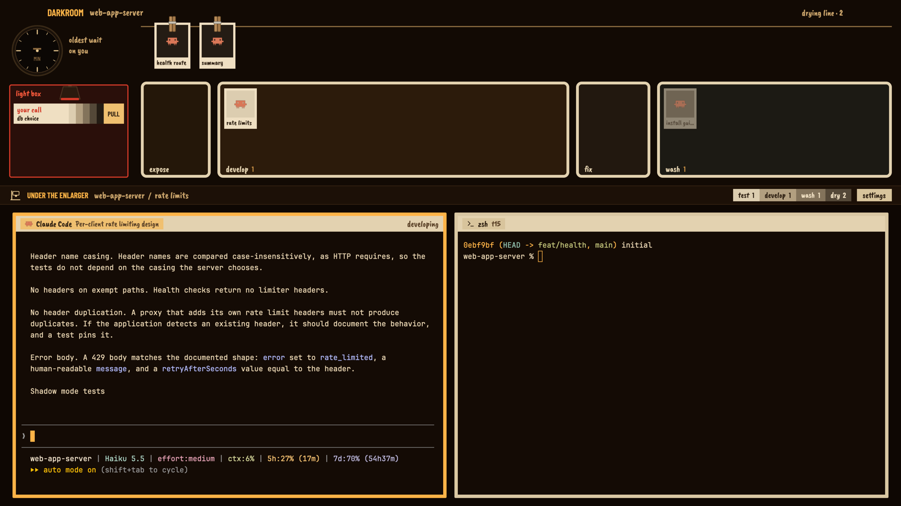

# Darkroom

Your agents as prints in a darkroom under amber safelight. Working agents
develop in the tray, getting darker the longer they work. Finished ones hang
on the drying line, and an agent that needs you lies on the light box as a
test strip under the red lamp. Click any print and its terminals go under the
enlarger.

## What you see

Three bands, top to bottom, no system title bar:

1. **The bay**, 330px (resizable 260–520), room color `#120a04`.
   - Top left, clear of the window buttons: "DARKROOM" in printed caps
     (Barlow Condensed, amber `#ffb347`) and the active space in grease pencil
     (Caveat Brush).
   - **Wall timer**: a process-timer face (`timer.svg`) showing, in minutes,
     how long the oldest blocked agent has waited ("--" when nobody waits),
     with "oldest wait on you" beside it.
   - **Light box** (left, under the timer): one test strip per blocked agent.
     Each strip is a paper label ("your call" in red pencil, the tab name),
     five stepped silver tones with the wait in minutes on the darkest band,
     and an amber PULL tab. The box and red lamp go dark when nobody needs you.
   - **Drying line** across the top right: finished agents hang from wooden
     pegs.
   - **Four trays** along the bottom in process order, white enamel rims
     (`#e3d2b0`): EXPOSE, DEVELOP, FIX, WASH, each with a grease-pencil label
     and count.
   - **Prints**: paper (`#efdfc2`) with the program icon as the photograph and
     the tab name penciled below. The image tone runs light to black through
     `#dccdb0 #b29f80 #83735b #544838 #241c14`.
2. **The rail**, 34px, bench color: an enlarger glyph, "UNDER THE ENLARGER",
   the active space / tab, station counts as a stepped test strip (test,
   develop, wash, dry), and a **settings** tag of masking tape at the far right
   (opens Herdr settings).
3. **The enlarger**: the active tab's live terminals on an easel. 6px enamel
   frames (`#d9c7a3`, amber when focused), 14px gaps; each pane's header is
   masking tape on the easel with the program and title in grease pencil, and
   the state in pencil on the right ("developing", "your call" in red, "on
   the line", "in the wash").

## How it behaves

| Status | Station | Print |
| --- | --- | --- |
| working | DEVELOP tray | darkens one tone every 4 minutes worked, black at 16+ |
| blocked | light box | a test strip: "your call", minutes waiting, PULL |
| done | FIX for 4s, then the drying line | fully developed, hung on a peg |
| idle | WASH tray | dark, faded |
| new (first 90s, not yet working) | EXPOSE tray | a blank, latent print |

- **Signature move**: every agent is one keyed print, so when its station
  changes it glides there once (1.1s ease-in-out on left/top). A finished
  agent travels develop tray → fixer → drying line.
- Click a print or strip: `agent.focus`, so its terminals go under the
  enlarger and the rail follows.
- **PULL** on a test strip presses Enter in that agent (`hc keys <address>
  enter`), which approves a waiting prompt without switching to it. Works for
  remote agents (addresses carry their machine, e.g. `dev-vm/t12`).
- Next/previous agent keys follow station order: test strips first, then
  expose, develop, fix, wash, drying line.
- Click a pane header to focus it, double-click to zoom.

## Built from

- **Layout** (`layouts/darkroom.json`): root `column`, `titlebar: "none"`,
  traffic lights at [14, 14], `theme: "darkroom"`, `ui_font: "Barlow
  Condensed"`. Blocks: `bay` (mod, role `bay`), `rail` (role `rail`,
  `window_drag`), `enlarger` (`content: { tab: "active", pane: { … header:
  role pane } }`).
- **One mod** (`mods/darkroom/`), roles by `props().role`: `bay.js`
  (default), `rail.js`, `pane.js`; `kit.js` holds palette, tones, fonts.
- **Data**: `agents()`, `spaces()` (tab `working_since` for print tone,
  `changed_at` for wait), `panes()`. **Commands**: `agent.focus`,
  `pane.focus`, `pane.zoom`, `app.settings`; `hc(["keys", addr, "enter"])`;
  `setAgentOrder()`.
- **Motion and time**: `.transition("left"/"top")` on keyed prints only. One
  60s timer re-renders (tones step, timer advances); one-shot timers after a
  finish (4s) and a new agent (90s). No `.loop` or `.frames`.
- **Size**: `on_size_change` on the bay; every position is computed from the
  real block size.
- **Art**: `timer.svg`, `peg.svg`, `lamp.svg`, `enlarger.svg`, authored here.
  **Fonts** (SIL OFL, licenses in `fonts/`): Caveat Brush, Barlow Condensed.

## Watch out

- PULL presses Enter: on a Claude Code permission prompt that picks the
  highlighted option (usually "Yes"). It does not read the prompt first.
- Wait time comes from the tab's last change, so it's per tab, not per agent.
- Print tone is time working, not progress; never read it as how far along
  an agent is.
- EXPOSE only knows agents that appear while this copy runs; agents present
  when the layout opens start in their status's station.
- Trays pile prints with a small offset when full; many agents in one tray
  overlap.

## Done when

- Every agent is in the station for its status, and the counts on trays and
  the rail match.
- A finishing agent glides tray → fixer → drying line once, with no ongoing
  animation afterwards.
- PULL approves a blocked agent; clicking a print shows its terminals.
- The settings tag opens Herdr settings.
- `herdr-app check mods/darkroom` passes.
