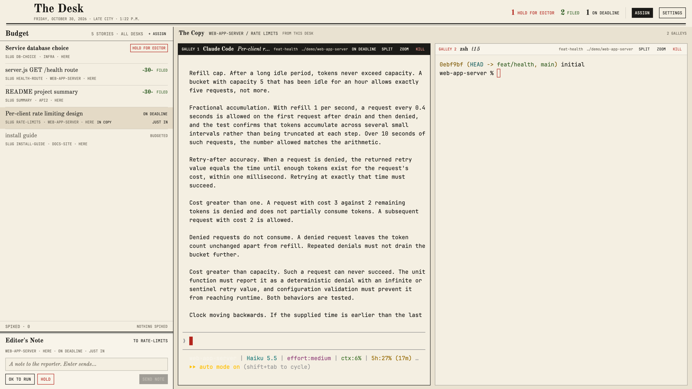

# The Desk

A newspaper wire desk at deadline. Every agent is a story on tonight's
budget, held stories first. You read one story's galleys in the copy, and
steer any other story from the editor's note without leaving the copy.

## What you see

Two bands, top to bottom, filling the window (no system title bar):

1. **The masthead**, 62px, newsprint (`#f4efe2`). After room for the window
   buttons: the nameplate "The Desk" (Old Standard TT, bold, 27px) over a
   wire-type dateline ("THURSDAY, OCTOBER 29, 2026 · LATE CITY · 2:14 P.M.").
   On the right, tonight's tally as figure + label pairs: HOLD FOR EDITOR (red
   when any), FILED (green-black `#2f5e24`), ON DEADLINE (ink). Then two
   standing buttons: **ASSIGN** (solid ink) and **SETTINGS** (ink box, opens
   Herdr's settings). A thick-and-thin double rule closes the masthead.
2. **The body**, a row divided by a 1px ink rule:
   - **The budget**, 400px (320–600, resizable). "Budget" heading, a story
     count and a "+ ASSIGN" mark, an ink hairline. Then every story, separated
     by half-pixel hairlines: line one is the headline (the agent's session
     title, else the tab name) in the serif, with the status word in wire caps
     on the right; line two is apparatus in wire type: SLUG, desk (space),
     machine (or HERE), IN COPY when it's the story you're reading, and its
     time on that status. The marked story has a tan wash (`#e4dac6`).
     Below: the **spiked shelf**, folded ("SPIKED · 3 · UNFOLD"), and the
     **editor's note** on a lighter sheet under a double rule: "Editor's
     Note", TO <SLUG>, the story's desk, machine and status, a note field,
     and OK TO RUN, HOLD (red) and SEND NOTE (solid).
   - **The copy**, the rest. A 30px rail: "The Copy", SPACE / TAB, FROM
     <MACHINE>, galley count. Below, the shown tab's live terminals on
     newsprint, 10px apart, square, 1px ink borders (solid ink when focused).
     Each has a 26px galley slug header: GALLEY n (red), program (bold
     serif), its title (italic), branch, folder, status word, and proof marks
     SPLIT, ZOOM, KILL. The galley you're in is set in reverse: paper on ink.

Type: Old Standard TT (bundled, OFL) for headlines and copy; JetBrains Mono
(ships with Herdr) for every piece of apparatus. Terminals are 13px JetBrains
Mono on newsprint with an ink-on-paper ANSI palette (`themes/desk.json`).

## How it behaves

| Status | Desk word | Look |
| --- | --- | --- |
| blocked | HOLD FOR EDITOR | red word in a red box, bold headline; sorts first |
| done | FILED | green-black word and a "-30-"; sorts second |
| working | ON DEADLINE | ink; time since it started working |
| idle | BUDGETED | dim headline and word |

- **Triage.** The budget covers every space on every machine, ranked held,
  filed, on deadline, budgeted (newest first inside each). The app's
  next/previous agent keys follow the budget's order.
- **Mark vs. open.** Click a story to mark it: the editor's note addresses it,
  and the copy doesn't change. Double-click, or hover and click OPEN, to bring
  its tab into the copy (`agent.focus`). With nothing marked, the note
  addresses the story in the copy.
- **Steer without switching.** Click the note field, type, Enter (or SEND
  NOTE): `hc send <terminal> <text>` (with `--force` when the story is held,
  so it answers the question). OK TO RUN presses Enter in its terminal
  (`hc keys <t> enter`): accepts the highlighted choice of a waiting prompt.
  HOLD interrupts its turn (`hc interrupt <t>`). The result line under the
  buttons says "NOTE SENT TO <SLUG> · 2:14 P.M." or "DID NOT REACH <SLUG>: …"
  in red. Terminals on dev-vm are addressed as `dev-vm/tN`. Esc in the note
  clears it and returns the keyboard to the copy.
- **Launch.** ASSIGN (masthead or budget) opens "Assign a Story": SLUG (the
  tab's name), DESK (any space, showing its machine), REPORTER (the agents
  installed on that desk's machine, asked with `knownAgents({ on })`, plus
  Shell), BRIEF (the first message). Enter or ASSIGN runs `tab.new { space,
  name, argv, task }`. Tab moves between slug and brief, Esc closes.
- **Organize.** Hover a story, SPIKE settles its tab (`tab.settle`); it
  leaves the budget unless it's held (a held story always stays). The
  spiked shelf unfolds to list settled tabs with RESTORE (`tab.unsettle`).
- **Signature: -30-.** When a story files (any status → done), a red ink
  wash lands on its row and fades over ~2s, and the "-30-" end mark inks in
  beside its headline. It stays while the story is filed. No other motion.
- **Settings.** The SETTINGS box at the right end of the masthead opens
  Herdr's settings (`app.settings`).
- Clicking a galley slug focuses it; double-click zooms.

## Built from

- **Layout** (`layouts/desk.json`): root `column`, `titlebar: "none"`,
  traffic lights at [14, 16], `theme: "desk"`, `ui_font: "Old Standard TT"`,
  terminal font JetBrains Mono 13. Masthead `block` (62px, window drag), then
  a `row` with an ink divider: `budget` block (400px) and a `copy` column
  (copyhead block 30px + `content: { tab: "active", pane: { … } }` with the
  `galley` header, 26px, `lone: true`).
- **One mod** (`mods/desk/`), roles via `props().role`: `masthead`,
  `budget` (default), `copyhead`, `galley`, `assign` (overlay dialog,
  `frame: "none"`, modal). `mod.json` is `place: "none"`.
- **Data:** `agents()`, `spaces()` (tabs: `settled`, `working_since`,
  `changed_at`, `named`), `panes()`, `focused()`, `knownAgents({ on })`.
- **Commands:** `agent.focus`, `tab.new`, `tab.settle`, `tab.unsettle`,
  `pane.focus`, `pane.zoom`, `pane.split`, `pane.close`, `app.settings`;
  `setAgentOrder()` on each budget render. `hc(["send"|"keys"|"interrupt", …])`.
- **Time:** one 60s timer in the budget (ages) and one minute-aligned timer
  in the masthead (dateline clock). Motion: two `transition("opacity")` on a
  filed story, bounded by timers (60ms, 2s). No `.loop` or `.frames`.
- **Art and type:** Old Standard TT Regular/Bold/Italic in `mods/desk/fonts/`
  (SIL OFL, license alongside); preview `layouts/desk.svg`.

## Watch out

- Selection lives in the budget copy only (the budget and the editor's note
  are one block on purpose); the galleys don't show which story is marked.
- OK TO RUN sends a bare Enter: it accepts whatever choice the program has
  highlighted. Read the story before pressing it.
- `hc send` waits for the terminal to pause before typing; a note to a busy
  story can take a moment, and the buttons read SENDING… until it returns.
- The note field is single-line typing (backspace, alt-backspace, ctrl-u),
  not a full editor; no paste.
- Spiked held stories stay on the budget; spiked others disappear until
  restored. Ages are Herdr's own `working_since` / `changed_at`, so they are
  blank for tabs Herdr hasn't seen change since it started.
- The masthead tally and the budget skip spiked stories (except held ones).
- Light paper terminals: programs that assume a dark background may show
  pale text; the ANSI palette is tuned for ink on paper.

## Done when

- Every agent is on the budget under the right desk word, held first, and
  the masthead tally matches.
- Marking a story retargets the editor's note without changing the copy;
  a note, OK TO RUN and HOLD reach that story's terminal (local and dev-vm)
  and the result line says so.
- ASSIGN starts a named tab with the chosen reporter and brief on the
  chosen desk's machine.
- SPIKE moves a story to the shelf and RESTORE brings it back.
- A story that finishes shows the wash and "-30-".
- SETTINGS opens Herdr's settings.
- `herdr-app check mods/desk` passes.
