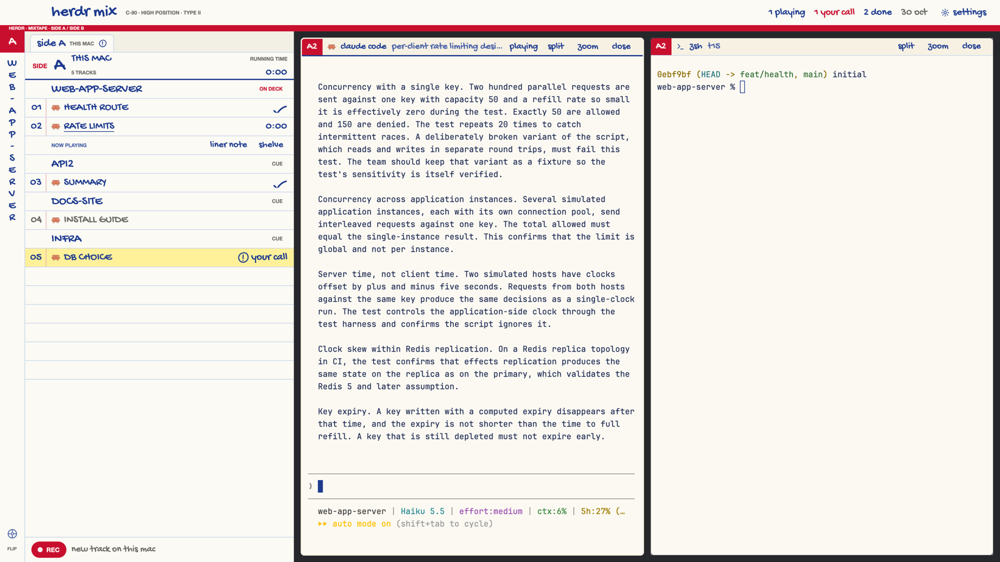

# Mixtape

Your agents as a mixtape's hand-lettered J-card. Every machine is a side of
the tape (Side A is this Mac, Side B is dev-vm), every tab on it is a track,
and running times are how long each agent has been working. Pick a track and
its live terminals play in the deck beside the card.

This file is the brief: enough to build Mixtape from an empty folder. The
files next to it are one build of it.

## What you see

No system title bar; the window is a smoked cassette shell (`#26272b`) with a
white lined inlay card (`#fbfaf4`) on it.

1. **The front flap**, 50px across the top. "herdr mix" hand-lettered (26px)
   after room for the traffic lights, "C-90 · HIGH POSITION · TYPE II"
   printed small, then live counts written in ballpoint: "2 playing",
   "1 your call" (red when above zero), "3 done", the date, and a
   **settings** button (pen-drawn gear + the word "settings", top right) that
   opens Herdr's settings. Under it, a 10px printed brand stripe in TDK red
   (`#c8102e`), the card's only printed colour.
2. **The card**, 470px wide on the left:
   - **The spine**, 40px: a red cap with the active side's letter, the active
     space's name hand-lettered down the spine one letter per line, a reel
     mark and "FLIP" at the foot. Click anywhere on it to flip sides.
   - **The inner fold**: tabs "side A · THIS MAC", "side B · DEV-VM", … (a
     pen "!" circle on a side with an agent waiting on you). Below, one side
     at a time: a heading (printed "SIDE", the letter at 30px, the machine,
     "N tracks" or "TAPE EATEN · UNREACHABLE", and the side's total running
     time), then the tracklist ruled on printed blue lines (`#c9d6ec`) with a
     pink margin line (`#e7b3b3`) after the track numbers. Spaces are
     song-group headings; tracks are tabs: number, program icon, title in
     block caps, and on the right margin the status mark. Six blank ruled
     lines follow, like any inlay. The foot has a red **REC** pill.
3. **The deck**, the rest: the active tab's terminals on cream paper
   (`#fbf9f2`), 10px gaps, 6px corners, a cream focus ring. Each has a 28px
   **tape label** header: a red tab with the track code (B3), program name,
   title, status word, and pen buttons split · zoom · close.

Type: Gochi Hand (bundled, OFL) for everything handwritten, Helvetica Neue
for the inlay's tiny printed caps, JetBrains Mono 13px in terminals. Ink is
ballpoint blue `#1d3a8f`; idle tracks are pencil gray `#6c6c68`.

## How it behaves

| Status | Track | Tape label |
| --- | --- | --- |
| working | ink title, running time `12:00` (m:ss, minute resolution, from `working_since`) | "playing" |
| blocked | yellow highlighter swipe across the row, pen-circled "!" + "your call" | "!" + "your call" |
| done | a ballpoint tick, drawn once left-to-right when it first turns done | tick + "done" |
| idle | pencil gray, "on hold" | "paused" |

- **Sides are machines.** Side A is this Mac; then reachable machines by
  name (dev-vm is B); unreachable ones last ("tape eaten"). A machine with
  spaces but missing from `machines()` still gets a side.
- The fold follows the active space's machine; click a side tab to read
  another side. Flipping slides the fold once (380ms ease-in-out on `left`).
- Click a track to play it: `agent.focus` its lead agent (blocked first),
  or select its space and tab.
- The playing track gets a second ruled line: **liner note** (a one-line
  follow-up sent to that agent with `hc send <machine/address> <text>`, no
  switching) and **shelve** (`tab.settle`). Shelved tabs fold into
  **BONUS TRACKS (n)** per side; **play** unshelves and plays.
- **Spine click** (or `mixtape.flip`) flips to the next side and plays its
  most urgent track (blocked, then done, then working).
- **REC** opens a blank card for that side's machine: SPACE chips (its
  spaces + "+ new space"), ARTIST chips (installed agents from
  `knownAgents({ on: machine })`, plus shell), and written fields TRACK NAME,
  NEW SPACE NAME (only for a new space) and FIRST TASK (not for shell). Tab
  moves between fields, Enter records, Esc cancels. Recording runs
  `tab.new { space, name, argv, task }` or `space.new { name, tab, machine,
  argv, task }`, so the agent starts on the right machine with its task.
- Running times refresh once a minute; nothing else ticks.

## Built from

- **Layout** (`layouts/mixtape.json`): root `column`, `titlebar: "none"`,
  `traffic_lights: [14, 17]`, `theme: "mixtape"`. A 50px `flap` block, then a
  `row`: the `card` row (470px, a 40px `spine` block + `sides` block) and the
  `deck` block with `content: { tab: "active", pane: { … header: label } }`.
- **One mod** (`mods/mixtape/`), roles by `props().role`: `flap`, `spine`,
  `sides`, `label`, and overlay cards `rec` and `note`. `kit.js` builds the
  tape model from `machines()`, `spaces()` and `agents()`.
- **Commands:** `agent.focus`, `space.select`, `tab.select`, `tab.settle`,
  `tab.unsettle`, `tab.new`, `space.new`, `pane.split/zoom/close/focus`,
  `app.settings`, and the mod's own `mixtape.flip` / `mixtape.rec` /
  `mixtape.side0..9` (listened for by the `sides` copy only).
- **Programs:** `hc send` for liner notes; `knownAgents` for the REC card.
- **Motion:** two bounded transitions only (the fold's `left`, a tick's
  `width`). No `.loop`, no `.frames`; one 60s timer (fold) and one 30-minute
  timer (date on the flap).
- **Art:** pen-drawn SVGs in `art/` (tick, circled "!", reel, gear), tinted
  ballpoint. Gochi Hand in `fonts/` with its OFL license.

## Watch out

- Running time is time in the working state, measured by Herdr, at minute
  resolution: the ":00" seconds are the tracklist costume, not precision.
- "C-90 · HIGH POSITION · TYPE II" and the stripe's text are printed
  decoration, not data.
- The written fields take typing, backspace, Alt/Cmd-backspace and Ctrl-U;
  no paste, no cursor movement.
- A liner note clears only on success; an `hc` error shows on the card.
- Terminals are light paper: a program forced into dark-terminal colours
  may read faintly.
- More than four machines make the side tabs crowd the card's width.

## Done when

- Each machine shows as a side, this Mac first, dev-vm second; an
  unreachable machine shows "tape eaten" and its REC is disabled.
- Tracks show the right status marks; a newly finished one draws its tick.
- Clicking a track plays its terminals in the deck; the spine flips sides.
- REC on Side B starts the chosen agent with its first task on dev-vm.
- A liner note reaches the playing agent's terminal.
- The settings button in the flap opens Herdr's settings.
- `herdr-app check mods/mixtape` passes.
