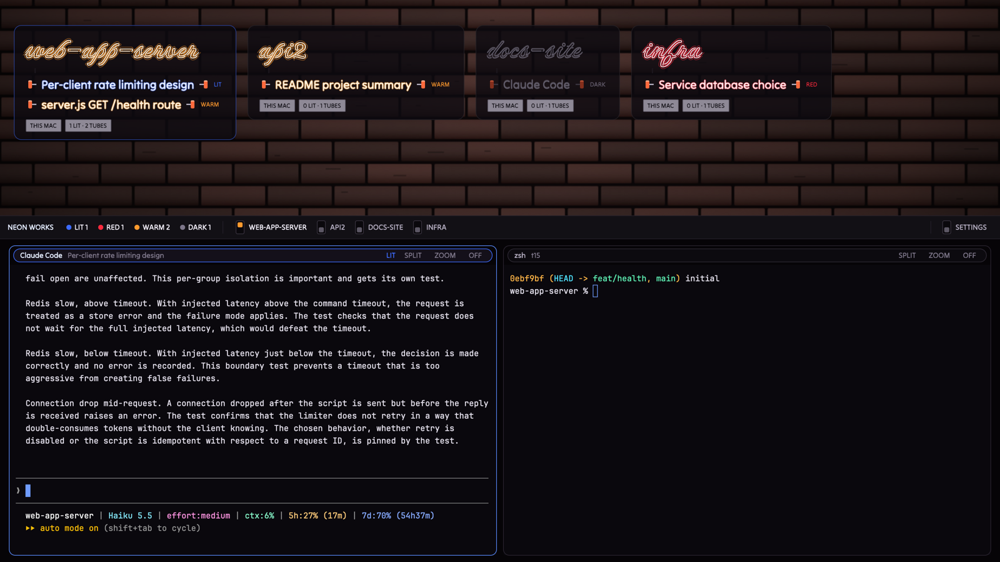

# Neon

Every space is a hand-bent neon sign on a brick wall, and every agent is a
tube in it. Working agents burn cobalt, blocked ones red, finished ones warm
amber; idle ones are clear, unlit glass. Click a tube and its live terminals
light up in the storefront below.

This file is the brief: enough to build Neon from an empty folder. The files
next to it are one build of it.

## What you see

Three bands, top to bottom, filling the window (no system title bar; the
macOS window buttons sit over the wall at 14, 14):

1. **The wall**, weight 0.8 (min 180px): a dark brick backboard
   (`mods/neon/art/brick.png`, cover-fit, vignetted), 40px clear at the top
   for the window buttons. One sign per space, wrapping left to right, 18px
   apart; the wall scrolls if there are more signs than fit. A sign is a
   smoked acrylic backer (`#0d0a10cc`, 12px corners, hairline edge, a cobalt
   edge `#3d6bff88` on the shown space) holding:
   - the space's name as the title, 46px, in Neonderthaw script, burning in
     the space's most urgent gas (or clear glass when nothing is live);
   - a short dark painted bridge under the title;
   - one tube line per agent (blocked first, then working, done, idle): a red
     electrode cap and glass lead at each end, the agent's session title
     (else its tab name) at 19px in Tilt Neon, and a small gas word: LIT,
     RED, WARM or DARK;
   - two stamped steel plates: the machine (`DEV-VM`, `THIS MAC`) and
     `n LIT · m TUBES`, or `NO POWER` when that machine is unreachable.
2. **The breaker panel**, 38px, `#121015`: "NEON WORKS", four lamp counts
   (LIT cobalt, RED, WARM amber, DARK), then one breaker per space (a small
   lever box, thrown up and colored for the shown space, and the space name),
   and at the right end the **SETTINGS** breaker.
3. **The storefront**, weight 1.2, padded 10 × 14px on `#060407`: the shown
   tab's live terminals on `#0a080d`, 10px corners, 10px gaps, a 1px
   `#2a2430` border (`#5a8cff` focused). Each pane's 30px header is a pill
   plaque outlined in its tube's gas: program name, title, gas word, and
   SPLIT, ZOOM and OFF switches.

Gases: working `#3d6bff` glow on a `#e3ebff` core, blocked `#ff2a3d` on
`#ffe3e6`, done `#ff9a2e` on `#fff1de`, idle glass `#5f5a68` with a faint
`#8f8a99` highlight. Electrodes `#a8391f`, hot `#ff6a3d`. Terminal text is
JetBrains Mono 13px; the layout's theme is `themes/neon.json`.

## How it behaves

| Status | Tube | Motion |
| --- | --- | --- |
| working | cobalt glow, hot electrodes, LIT | strikes once when it starts: glass, flash, glass, flash, steady (85ms steps) |
| blocked | red glow, RED | stutters once when it blocks: on, off, on, off, flash, off, steady red |
| done | warm amber glow, WARM | none; it goes back to glass once you've looked (Herdr turns done into idle) |
| idle | clear unlit glass, DARK | none |

- Click a tube: `agent.focus` (its space and tab show; the storefront fills
  with its terminals). Click a sign's backer, or its breaker: that space shows.
- **Settings:** the SETTINGS breaker at the right end of the breaker panel
  runs `app.settings`.
- Pane plaques: click focuses, double-click zooms; SPLIT splits right, ZOOM
  toggles zoom, OFF closes the pane.
- The app's next/previous agent keys walk blocked, then working, done, idle.
- Nothing animates while nothing changes: the glow is static styling, and the
  strike and stutter are short, bounded sequences triggered by a status change.

## Built from

- **The layout** (`layouts/neon.json`): a root `column`, `titlebar: "none"`,
  `traffic_lights: [14, 14]`, `theme: "neon"`, `ui_font: "Tilt Neon"`,
  `font: "JetBrains Mono"`. Children: `wall` block (weight 0.8, background
  image, `window_drag`), `breakers` block (38px), `storefront` column holding
  `main` with `content: { tab: "active", pane: { … } }` whose header is this
  mod with `role: "plaque"`.
- **One mod** (`mods/neon/`), `props().role`: `wall` (also the fallback),
  `breakers`, `plaque`. `kit.js` holds the gases, the `tube()` element and
  electrodes/plates.
- **The tube:** the text drawn five times. Four copies offset by about a
  sixteenth of the font size in the gas color at 45% opacity, plus one
  centered copy, form the halo; a pale core sits on top. Unlit, only the
  glass core and a 1px highlight copy show. The halo group's opacity has an
  80ms `transition`, so strike/stutter steps fade between levels.
- **Data and commands:** `agents()`, `spaces()`, `machines()` (unreachable
  machine = NO POWER), `panes()`; `run("agent.focus", { terminal })`,
  `run("space.select", { id })`, `run("pane.split" | "pane.zoom" |
  "pane.close" | "pane.focus", …)`, `run("app.settings", {})`;
  `setAgentOrder()` on wall renders.
- **Motion:** status diffing in the wall's render; a changed agent gets a
  sequence of glow levels stepped by `cx.timer.after(85)` and then removed.
  No `.loop`, no `.frames`, no polling timers.
- **Art:** `art/brick.svg` (generated, deterministic) rasterized to
  `art/brick.png` with Quick Look; `layouts/neon.svg` preview.
- **Fonts** (bundled, SIL OFL, licenses in `fonts/`): Neonderthaw (sign
  titles) and Tilt Neon (tubes and UI, variable font, default instance).

## Watch out

- GPUI panicked in `herdr-app check` on a `.transition("top", …)` on the
  breaker lever's thumb; the lever is thrown instantly instead. Give any
  animated element an `.id()`.
- A blur filter on a zero-height SVG `<line>` renders nothing (empty
  bounding box); the preview fakes line glow with a wide translucent stroke.
- Quick Look rasterizes SVGs into a square canvas; the brick art is authored
  square (1800 × 1800) so nothing pads white. The layout cover-fits it.
- Neonderthaw is a decorative script: short space names read best. Session
  titles are truncated at 32 characters per tube.
- A tube line is one agent; several agents in one tab show as separate
  tubes with their own session titles.
- The halo is five text copies per lit tube; fine for tens of agents, not
  hundreds.
- If `neon` is taken, rename the layout, theme, mod folder, `mods/neon/…`
  paths and the `mod` names in the layout together.

## Done when

- Every space is a sign and every agent a tube in its space's sign, in the
  right gas; the breaker counts add up.
- A newly working agent's tube strikes once and holds; a newly blocked one
  stutters once and holds red; nothing moves otherwise.
- Clicking a tube shows its terminals in the storefront; clicking a breaker
  or sign switches space; SETTINGS opens Herdr's settings.
- `herdr-app check mods/neon` passes, and switching away and back works.
