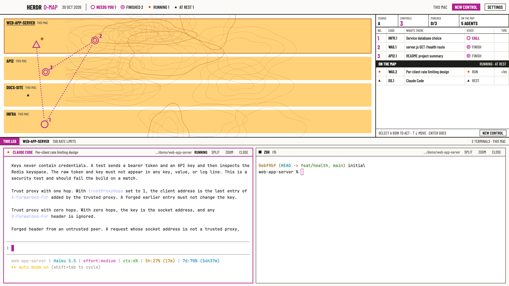

# Orienteering

Your agents as an orienteering map. Spaces are terrain, agents are features,
and a purple course runs from where you stand through every agent that needs
you, in order. Act on any of them from the control description sheet without
switching to it.

This file is the brief: enough to build Orienteering from an empty folder. The
files next to it are one build of it.

## What you see

Four bands, top to bottom, filling the window (no system title bar):

1. **The map margin**, 46px, paper (`#fbfaf6`), 2px black rule below. 84px
   left of it is kept clear for the macOS window buttons. "HERDR" (20px bold)
   and "O-MAP" in course purple, the date, a hairline, then the legend: each
   status's map symbol with its word and live count (NEEDS YOU, FINISHED,
   RUNNING, AT REST). On the right: the machines on the map ("THIS MAC ·
   DEV-VM"), a filled purple **NEW CONTROL** button and an outlined
   **SETTINGS** button (runs `app.settings`). This is where Settings lives.
2. **The board**, flexible (weight 1, min 240px):
   - **The map** (all width but the sheet). White forest ground. Each space is
     a terrain zone, one column per machine, zone heights by agent count:
     this Mac = yellow open land (`#ffd27a`), dev-vm = white forest with a 4px
     olive thicket edge (`#5f9e3c`), other machines = green with a 2px edge,
     an unreachable machine = marsh (blue dashed hatching). Brown contour
     lines (one authored SVG, stretched) lie over the zones. Zone names in
     black condensed caps, the machine beside them; the shown space's name is
     underlined.
   - Each agent is a feature at a stable spot in its zone (grid + jitter from
     its address): a brown knoll dot while running, a black boulder triangle
     at rest. Agents that need you are **controls**: a purple circle (blocked)
     or a finish double circle (done), numbered in purple condensed numerals.
   - **The course**: a dotted purple line from the start triangle (placed at
     the focused agent, else bottom-left) through every control in order.
   - **The control description sheet**, 420px, right, 2px black rule. A box
     row: COURSE A, CONTROLS (purple when any), PUNCHED n/total, ON THE MAP n
     AGENTS. Column heads NO. / CODE / WHAT'S THERE / STATE / TIME in a
     hairline grid. Rows: the course first (number, ticker like `WAS.2`, the
     agent's title, symbol + CALL/FINISH, time in state), then ON THE MAP
     (running and resting agents), then PUNCHED (struck through). A status
     line and a NEW CONTROL button at the bottom.
3. **The rail**, 26px: a purple "THIS LEG" tab, the shown space's name, its
   tab, and "n TERMINALS · MACHINE".
4. **The leg**, the rest (weight 1.15): the shown tab's live terminals on
   white, 8px gaps, square corners, 1px black borders, 2px purple when
   focused. Pane headers are 26px legend strips: status symbol, program,
   title, folder, state word, and SPLIT / ZOOM / CLOSE text actions.

Type: Barlow Condensed (bundled, OFL) for everything around the terminals;
terminals in JetBrains Mono 13. Inks: black `#1d1d1b`, brown `#c4691e`, olive
`#5f9e3c`, blue `#2ea3dc`, course purple `#b0208e` (only for the course and
what needs you).

## How it behaves

| Status | Map | Sheet |
| --- | --- | --- |
| blocked | numbered purple control circle, on the course | CALL in purple, first in order |
| done | numbered finish double circle, on the course | FINISH, after the blocked ones |
| working | brown knoll dot | ON THE MAP, RUNNING, time since it started |
| idle | black boulder | ON THE MAP, REST |

- **Course order**: blocked first, then done; oldest change first within each.
  `agent.next`/`agent.prev` follow the sheet (course, then map, then punched).
- **Select** a feature on the map or a row on the sheet (↑/↓ also move, Enter
  goes, Esc clears). The selected row opens its actions:
  - **GO**: `agent.focus` (double-click a row or feature does the same).
  - **APPROVE** (blocked only): `hc keys <address> enter`, answering the
    agent's dialog with its default (Claude Code: Yes).
  - **HOLD** (working/blocked): `hc interrupt <address>`.
  - **Follow-up**: click the field, type, Enter: `hc send <address> <text>`.
    hc refuses to type into a blocked agent's dialog; the sheet shows why.
  - **PUNCH** (controls): marks it handled. It leaves the course, which
    re-routes; it comes back by itself when the agent changes state again.
    UNPUNCH puts it back.
- Results show in the sheet's status line ("APPROVED WAS.2", or the error).
- **Signature move**: when the first control changes (punched, cleared, a new
  one arrives), features glide to new spots (700ms ease-out) and a purple
  halo around the new control 1 fades out once (1.4s). Nothing loops.
- **NEW CONTROL** (header or sheet) opens a dialog: pick the space (which
  decides the machine), the runner (Claude Code, Codex, Shell; Tab cycles)
  and the first task; Enter or PLACE CONTROL runs `tab.new {space, argv,
  task}`. Esc closes.
- Click a zone name to show that space. Elapsed times refresh once a minute.

## Built from

- **Layout** `layouts/orienteering.json`: root `column`, `titlebar: "none"`,
  `theme: "orienteering"`, `ui_font: "Barlow Condensed"`; blocks `header`
  (46px, window drag), `board` (weight 1), `rail` (26px) and `main`
  (`content: { tab: "active", pane: {…} }`, weight 1.15, header role `pane`).
- **One mod** `mods/orienteering/`, roles via `props().role`: `header`,
  `board` (also the fallback), `rail`, `pane`, `launch` (overlay). `kit.js`
  holds inks, units (`u(n) = n / zoom`), course ordering, punch store and the
  hc calls.
- **Data**: `agents()`, `spaces()` (tab `changed_at` / `working_since`),
  `panes()`, `focused()`, `machines()` (unreachable machines);
  `setAgentOrder()` on board renders.
- **Commands**: `agent.focus`, `space.select`, `tab.new`, `pane.split`,
  `pane.zoom`, `pane.close`, `pane.focus`, `app.settings`; `hc(["keys"…])`,
  `hc(["interrupt"…])`, `hc(["send"…])` with the agent's machine-qualified
  address (`dev-vm/t12`), so steering reaches agents on dev-vm.
- **State**: punched controls in shared `orient.punched` (address → status @
  tab `changed_at`), read once when the board starts and written on punch.
- **Art**: `art/contours.svg` (stretched once), `art/boulder.svg`,
  `art/start.svg`, `art/marsh.svg`; the course is 3px dots placed along each
  leg (capped at 520 dots). The map is laid out from the board's real size
  (`on_size_change`), not fixed pixels.

## Watch out

- Map feature positions come from a grid inside each zone; with many agents
  in one small zone, symbols crowd. The course is drawn with dots because
  GPUI has no line primitive.
- Punches are this layout's own and survive restarts; another layout won't
  know about them.
- APPROVE presses Enter: on a dialog whose default isn't "yes", Enter does
  whatever that default is. HOLD stops the agent's current turn.
- Follow-ups use `hc send`, which waits for a person to pause typing and
  refuses blocked dialogs (it won't force).
- The board's map only draws once its size is known (first layout pass).
- Only the board copy keeps punches; the header's legend counts statuses, not
  unpunched controls.

## Done when

- Every space appears as a zone in its machine's column, every agent as a
  feature, and controls are numbered blocked-first.
- Selecting a blocked control and pressing APPROVE answers its dialog; a
  follow-up reaches a working agent on dev-vm without switching to it.
- PUNCH removes a control and the course re-routes; a new state brings it back.
- NEW CONTROL starts an agent with its task in the chosen space.
- SETTINGS in the header opens Herdr's settings.
- `herdr-app check mods/orienteering` passes.
