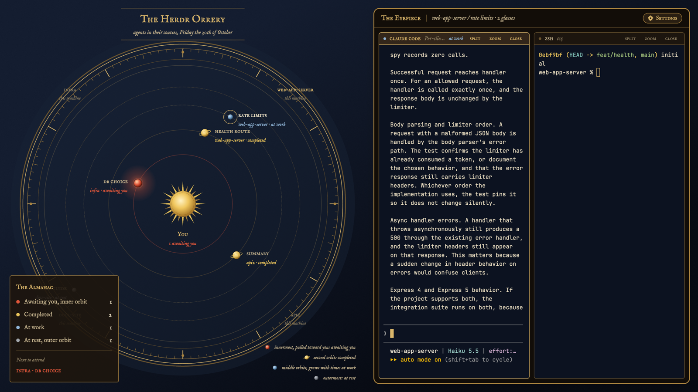

# Orrery

Your agents as planets of a Victorian brass orrery, and the sun is you. How
close a planet orbits says how much it needs you: blocked agents are pulled
into the innermost orbit, glowing ember red. Click a planet and its tab's live
terminals come into the eyepiece on the right.

This file is the brief: enough to build Orrery from an empty folder. The files
next to it are one build of it.

## What you see

Two halves side by side, no system title bar, on an ink-blue gradient
(`#141d30` → `#070a12`):

1. **The dome** (left, weight 1.1, min 520px): a graduated brass dial (120
   engraved ticks, long every 30°) over a faint glass disc. Five hairline
   orbits; the two working orbits are dashed. The engraved sun sits at the
   centre, "You" beneath it, and "N awaiting you" in ember when any agent is
   blocked. Every agent is a planet:
   - blocked: innermost orbit (0.30 R), ember sphere `#e0563a` with a soft halo;
   - done: second orbit (0.45 R), gold sphere with a Saturn ring `#e8c25a`;
   - working: middle orbits (0.60 R or 0.71 R, by a hash of its address),
     brass-blue sphere `#8fb4d6`, growing from 20 to 34px with time at work;
   - idle: outer orbit (0.84 R), pewter `#a3a8ae`.
   Beside each planet: its tab name in small caps, and "space · status" in
   italic, e.g. "dev-vm space · at work, 12 min". The focused agent wears a
   brass focus ring.
   - Each space owns an equal angular sector of the dial, starting at 12
     o'clock; its name and machine ("on dev-vm" / "this machine") are engraved
     at the rim, with a brass pin at the sector boundary. A planet's longitude
     inside its sector is fixed by a hash of its address, so it never shuffles.
   - Top: the cartouche "The Herdr Orrery", "agents in their courses,
     Thursday the 29th of October", between brass hairlines.
   - Bottom left: **the Almanac**, a brass-edged plate counting each status,
     and "Next to attend": the most recent blocked agent, else the most recent
     done one, else "All quiet in the heavens."
   - Bottom right: the legend, one line per orbit with its planet.
2. **The eyepiece** (right, weight 1, min 420px), inset 18px: a walnut panel
   (`#120d08`) with a 2px brass bezel `#a8823f`, 14px corners and a large
   shadow. A 44px rail says "The Eyepiece", then "space / tab, on machine ·
   N glasses", and at the far right **the Settings button**: a brass pill with
   a gear and "Settings" in small caps. Below, the active tab's live terminals
   (`#0c1220`, 6px corners, 10px gaps, 1px `#6b5530` borders, brass when
   focused) under 28px engraved plaques: a status dot, the program in small
   caps, the terminal title in italic, the status word, and split, zoom,
   close.

Type: IM FELL English (italic) and IM FELL English SC (small caps), bundled
in `fonts/` (OFL). Terminals: JetBrains Mono 13px. Theme `orrery`: parchment
`#e8dcc0` on ink `#0c1220`, brass accent `#d9b56a`.

## How it behaves

| Status | Orbit | Planet | Words |
| --- | --- | --- | --- |
| blocked | innermost, 0.30 R | ember, haloed | "awaiting you" |
| done | 0.45 R | gold, ringed | "completed" |
| working | 0.60 / 0.71 R | brass-blue, grows with time | "at work, 12 min" |
| idle | outermost, 0.84 R | pewter | "at rest" |

- When an agent's status changes, its planet glides to the new orbit along a
  straight line (`left`/`top` transitions, 900 ms ease-out). Nothing moves
  otherwise: no spin, no loop.
- Click a planet: `agent.focus`, so its space and tab come into the eyepiece.
  Click a sector name: `space.select`. Click "Next to attend": `agent.focus`.
- `agent.next` / `agent.prev` walk the planets from the inside out (blocked,
  done, working, idle), then by longitude.
- Plaques: click focuses the pane, double-click zooms; split, zoom and close
  run on that pane.
- **Settings**: the brass pill at the right end of the eyepiece rail runs
  `app.settings`.

## Built from

- **The layout** (`layouts/orrery.json`): a root `row`, `titlebar: "none"`,
  `traffic_lights: [16, 16]`, `theme: "orrery"`, a gradient background,
  `ui_font: "IM FELL English"`. Children: the `dome` block (mod `orrery`,
  role `orrery`, `window_drag`), and an `eyepiece-mount` column (padding 18)
  holding the bezelled `eyepiece` column: the `eyepiece-rail` block (44px,
  role `eyepiece`) and `main` with `content: { tab: "active", pane: { … } }`,
  whose header is the mod with role `plaque` (28px).
- **One mod** (`mods/orrery/main.js`), roles `orrery` (default), `eyepiece`,
  `plaque`. Data: `agents()`, `spaces()` (sectors, `working_since`),
  `panes()`, `focused()`, `settings().zoom`. Commands: `agent.focus`,
  `space.select`, `pane.focus`, `pane.zoom`, `pane.split`, `pane.close`,
  `app.settings`; `setAgentOrder()` on every dome render.
- **Size**: the dome reads its real size with `on_size_change` and computes
  every orbit and planet position (cos/sin) per render; the dial's radius is
  `min(W/2 − 40, H/2 − 70)`.
- **Art** (`art/`): `dial.svg`, `sun.svg`, four planet spheres with radial
  gradients, `halo-blocked.svg`, `halo-focus.svg`, and `gear.svg` (tinted).
- **Time**: one 60 s timer re-renders the dome (working planets grow, the
  date turns). No other timers, no polling, no programs run.

## Watch out

- Animate only on events. A perpetual orbit (`.loop`, `.frames`, `spin`)
  repaints the whole window forever and slowed this app badly in testing.
- Two `transition` calls on one element (left and top) are relied on; if a
  build drops one, planets jump on one axis.
- Planet labels are 170px wide beside the planet; with many agents in one
  space and orbit, labels can overlap. Sectors are equal per space, not per
  agent count.
- Working-planet size grows with time at work from the tab's `working_since`;
  it is not progress.
- A new mod folder without `mod.json` gets auto-docked into the shown layout.
  Create `mod.json` (`"place": "none"`) before anything else in the folder.

## Done when

- Every agent is a planet on the orbit for its status, in its space's sector.
- Changing a status moves the planet to its new orbit with a glide.
- Clicking a planet shows its terminals in the eyepiece and the rail follows.
- The Settings pill opens Herdr's settings.
- `herdr-app check mods/orrery` passes, and switching away and back works.
