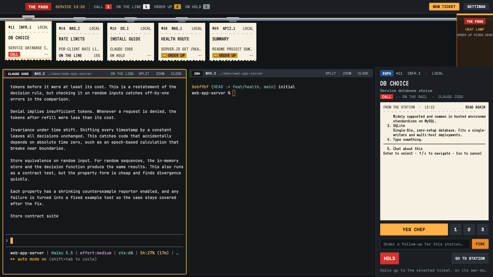

# The Pass

A restaurant line at service for running many agents at once. Every agent is
a thermal ticket clipped on a steel rail; the active tab's terminals are the
cooking line; the expo station on the right reads and calls the selected
ticket (answer its prompt, interrupt it, send a follow-up) without switching
to it.

## What you see

Top to bottom, filling the window (no system title bar):

1. **The header**, 44px, brushed steel (`#1b1f23`). 82px left for the macOS
   window buttons, then "THE PASS" on red label-maker tape, "SERVICE 14:20"
   in heat-lamp amber (`#ffb347`), and four tallies: CALL (red `#d7332b`),
   ON THE LINE, ORDER UP (brass `#c99a1e`), ON HOLD. On the right, an amber
   **NEW TICKET** plate and a steel **SETTINGS** plate.
2. **The rail**, 172px, dark steel (`#121518`). A polished rail bar runs
   across; every agent hangs from it on a clip as a cream thermal ticket
   (`#f6f1e3`, 152px wide, torn bottom edge) set in VT323: `#12  WAS.1`
   and the machine, a dashed rule, the order (tab name, 19px, two lines),
   the agent's title, then its call stamp and time on the rail. The selected
   ticket hangs higher with an amber border. The right 118px is the pass end
   under the heat lamp, an amber-edged bay labeled "THE PASS".
3. **The service row**: the line and the expo station, split by a 1px rule.
   - **The line**, the remaining width: the active tab's real terminals,
     8px gaps, 4px corners, 1px steel borders, a 2px amber border on the
     focused one. Each pane's 28px header is a station label: the program
     on label-maker tape (red when blocked, blue when done, black otherwise),
     its ticket (`WAS.1`), its folder, its call, and SPLIT / ZOOM / CLOSE.
     The focused station has an amber bottom edge.
   - **The expo station**, 380px (320–560, resizable), steel. The EXPO tape and
     the selected ticket's number, station and machine; its order in 26px
     VT323; title, call stamp, time and cook; a cream paper strip "FROM THE
     STATION" with the terminal's last 9 lines and READ AGAIN; then the
     callouts: **YES CHEF** (amber) and **1 / 2 / 3**; the follow-up field
     and **FIRE**; **HOLD** (red) and **GO TO STATION**; and one feedback line.

Type: Space Mono (bundled) for tape and UI, VT323 (bundled) for tickets,
JetBrains Mono 13px in terminals.

## How it behaves

| Status | Ticket | Rail position | Motion |
| --- | --- | --- | --- |
| blocked | red **CALL** stamp | pulled to the front | shakes once (~0.8s) when it starts calling |
| working | ON THE LINE | after the calls, oldest fire time first | none |
| idle | ON HOLD | after the line | none |
| done | brass **ORDER UP** stamp with a bell | the pass end | slides there once (`left` transition, 0.7s) |

- Click a ticket: it becomes the expo's ticket (it doesn't move focus).
  Double-click: go to its station (`agent.focus`).
- The expo reads the ticket's screen (`hc read`) when it is picked, when its
  status changes, after every call, and on READ AGAIN. Never on a timer.
- **YES CHEF** presses Enter on the waiting prompt; **1 / 2 / 3** press that
  digit. Both only work on a CALL (dimmed otherwise, so a digit never lands in
  an idle agent's input).
- **HOLD** interrupts the turn (`hc interrupt --timeout 3`), for a working or
  calling ticket.
- **FIRE** sends the typed follow-up (`hc send`; with `--force` on a CALL so
  it answers the prompt). Enter fires, Esc clears and returns to the pane.
- Addresses are machine-qualified (`dev-vm/t12`), so every call runs on the
  agent's own machine through `hc`.
- **NEW TICKET** opens a ticket-shaped dialog: station (each space, with its
  machine; Up/Down), cook (Claude Code, Codex, Shell; Tab), and the order,
  which becomes the agent's first message and the tab's name. Enter fires
  `tab.new { space, name, argv, task }`; Esc closes.
- **SETTINGS** (header, far right) opens Herdr's settings (`app.settings`).
- Ticket times and the service clock refresh once a minute.
- The app's next/previous agent keys follow the rail's order.

## Built from

- **Layout** (`layouts/pass.json`): a root `column`, `titlebar: "none"`,
  `traffic_lights: [14, 14]`, `theme: "pass"`, `ui_font: "Space Mono"`.
  Children: `header` block (44px, `window_drag`), `rail` block (172px), and a
  `service` row of `main` (`content: { tab: "active", pane: { … header: pass
  role station, 28px } }`) and `expo` (380px).
- **One mod** (`mods/pass/`) in roles via `props().role`: `header`, `rail`,
  `station` (pane header), `expo`, `order` (an overlay). `kit.js` holds the
  palette, faces, rail order, label tape and steel plates.
- **Shared selection without re-rendering everything:** the selected ticket
  lives on `globalThis.__herdrPass` with a waiter list; rail and expo
  `cx.spawn` a loop awaiting `changed()` and notify themselves. No
  `setShared`, so picking a ticket redraws two copies, not every mod.
- **Data:** `agents()`, `spaces()` (working_since / changed_at for times,
  machine for stations), `panes()`, `focused()`.
- **Commands:** `agent.focus`, `pane.focus`, `pane.split`, `pane.zoom`,
  `pane.close`, `tab.new`, `app.settings`; `setAgentOrder()` on rail renders;
  `hc read | keys | interrupt | send` from the expo.
- **Key commands** (`pass.<command>` in keys.json, handled by the expo):
  `yes`, `hold`, `fire` (focus the follow-up line), `next`, `prev`, `go`, `new`.
- **Art:** `clip.svg`, `tear.svg` / `tear-sel.svg` (torn ticket edge),
  `bell.svg`; fonts in `fonts/` with their OFL licenses.

## Watch out

- `herdr-app check` only renders the role-less copy with no data. A copy
  forced to draw tickets panics in check's hidden window on
  `.transition("left", …)`, which a one-line test reproduces on any element;
  the same call is what Pasture uses live. Verify the rail slide in the app.
- YES CHEF assumes the waiting prompt takes Enter for its default answer
  (Claude Code's permission prompts do); 1/2/3 assume numbered choices.
- `hc send` waits for the terminal to pause; a long send shows "…" until it
  returns. HOLD reports what `hc interrupt` says, within 3s.
- The rail scrolls sideways past ~8 tickets; the pass-end bay covers the
  last 118px, which the scroll width accounts for.
- NEW TICKET's cooks are fixed (claude, codex, shell); an agent that isn't
  installed on the station's machine fails in its new tab.
- The service clock and tally colors are hardcoded to this palette.

## Done when

- Every agent hangs on the rail with the right stamp, in rail order, and the
  header tallies add up.
- A CALL ticket picked on the rail shows its prompt in the expo strip, and
  YES CHEF / a digit answers it without switching panes; FIRE reaches a
  dev-vm agent; HOLD stops a working one.
- A finishing agent's ticket slides to the pass end with ORDER UP.
- NEW TICKET starts the chosen cook in the chosen space with its first order.
- SETTINGS opens Herdr's settings.
- `herdr-app check mods/pass` passes, and switching away and back works.
